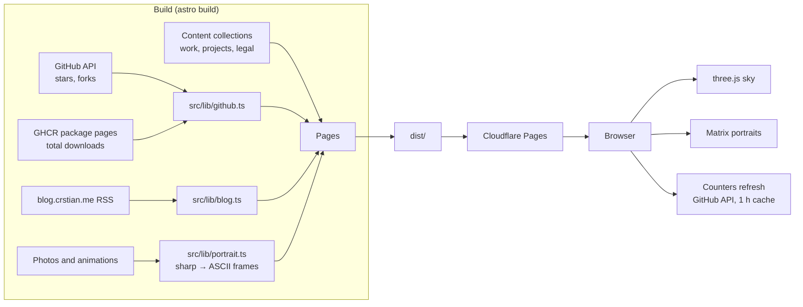

# crstian.me Architecture

<!-- In-repo doc. English. Relative Markdown links only. -->

This document describes how **crstian.me** is put together: a static Astro site, styled after the blog, laid out full screen over a three.js sky. It is for anyone changing the code, including an LLM working in the repo.

---

## Overview

The site is fully static: `astro build` renders every page to HTML, and Cloudflare Pages serves `dist/`. Data that changes over time (GitHub stars, container pulls, the latest blog posts) is fetched **at build time**, with fallbacks so a failing API never breaks the build. A few things run in the browser: the sky, the matrix portraits, the stack cloud or orbit, the theme toggle, the GitHub counters and the project sort.

## Pages

| Route | File | Notes |
|---|---|---|
| `/` | `src/pages/index.astro` | Hero, projects bento, blog posts, tech stack, contact |
| `/work` | `src/pages/work/index.astro` | One section per role, sticky dates, skills per role |
| `/projects` | `src/pages/projects/index.astro` | Static grid; Newest / Most stars sort (`?sort=stars`) |
| `/projects/<slug>` | `src/pages/projects/[...slug].astro` | Logo, metadata and the project's markdown |
| `/search` | `src/pages/search/index.astro` | Fuse.js search over the projects (SolidJS island) |
| `/legal/<slug>` | `src/pages/legal/[...slug].astro` | Terms and privacy |
| `/rss.xml` | `src/pages/rss.xml.ts` | Feed of the site's own collections |

## Design system

The look is shared with the blog (`~/Dev/My-blog`, Astro Litos theme):

- **Tokens** in `src/styles/global.css`: oklch "L C H" triplets around purple 285 (`--brand`, `--brand-2` cyan, `--brand-3` pink) and a pure-black (OLED) dark mode. `tailwind.config.mjs` maps them to Tailwind colours with `oklch(var(--x) / <alpha-value>)`, so `bg-primary/15` works.
- **Fonts**: Geist (body), Lexend (headings), Geist Mono (labels), self-hosted in `public/fonts/`.
- **Shared classes**: `.frame` (page width), `.panel` (glass card), `.eyebrow` (numbered section label), `.pill`, `.tag`, `.gradient-text`, `.project-logo`.
- **Theme**: `public/js/theme.js` (light / dark / system, stored in `localStorage.theme`, with the blog's wipe transition), toggled by `ThemeToggle.astro`.
- **Logos**: `public/stack.svg` is the blog's sprite of tech logos, one `<symbol>` per tool (single-colour ones use `currentColor`). `STACK` in `src/consts.ts` gives each its name and link. Project and UI icons come from Iconify (`icon-[set--name]` classes).
- No em dashes in the copy.

## The sky

`src/components/space/SpaceBackground.astro` mounts a fixed full-screen canvas, persisted across view transitions, and lazy-loads `space.ts`:

1. **Nebula**: a full-screen fbm shader in the brand colours with a Milky Way band.
2. **Stars**: about 7k point sprites, denser along the band, with twinkle, mouse parallax and a scroll dolly.
3. **Shooting stars**: a short streak now and then.

The canvas is opaque and *is* the page background (black or near-white). It pauses on hidden tabs, renders one frame under `prefers-reduced-motion` and caps the pixel ratio at 1.5.

## Matrix portraits

`MatrixPortrait.astro` is used twice: the hero photo (circle) and the Charmander scene in the contact section (rounded rectangle, animated).

- **Build time** (`src/lib/portrait.ts`): sharp crops or keeps the image's proportions, samples a grid of cells, picks a glyph per cell from its luminance (optionally contrast-stretched for flat cartoons) and stores colours as 12-bit hex. Animated gif/webp sources produce one grid per frame.
- **Browser**: falling drops "print" each cell; a halo after Magic UI's Glyph Matrix surrounds the image with faint mutating glyphs tinted by the nearest edge; once formed, a few cells flicker. Hover, focus or tap fades to the real image.
- It only animates while on screen and draws a still frame under reduced motion.

## Tech & tools

`TechOrbit.astro` renders the legend (three group cards, the blog's groups) and a Cloud / Orbit switch, remembered in `localStorage`:

- **Cloud**: `TechCloud.astro`, a port of Magic UI's Icon Cloud to plain TypeScript (canvas, Fibonacci sphere). Hovering a legend item turns that logo to the front.
- **Orbit**: CSS 3D rings around a Kubernetes core, animated with a registered `--spin` property.

## Projects data

`src/lib/github.ts` (`withGithubStats`) enriches the projects collection at build time:

| Data | Source | Fallback | In the browser |
|---|---|---|---|
| Stars, forks | `api.github.com/repos/<owner>/<repo>` | `stars` / `forks` in the frontmatter | Counted up and refreshed by `GithubCounts.astro` (1 h `localStorage` cache) |
| Container pulls | "Total downloads" on the GHCR package page | `pulls` in the frontmatter | Build time only: the page can't be fetched cross-origin |

Card logos are files next to each project (`logo.webp`), built by `scripts/project-logo.ts`. See [Content](./content.md).

## Key decisions

- **Static over SSR**: everything that changes is fetched at build time with fallbacks, so the site stays a plain `dist/` on Cloudflare Pages and never depends on an API being up.
- **Hand-ported components over adding React**: Magic UI is React; its Icon Cloud, Glyph Matrix and Scroll Progress were ported to plain TypeScript or CSS instead of adding a third island framework.
- **Tailwind 3 kept**: the blog is on Tailwind 4, but the tokens are mapped into Tailwind 3 here rather than migrating every component.
- **ASCII computed at build time**: the browser only draws; sharp does the image work, and the frames ship compressed in the HTML.

## Related docs

- [Content](./content.md): adding projects, jobs and legal pages.
- [Deployment](./deployment.md): Cloudflare Pages, previews and archiving versions.
