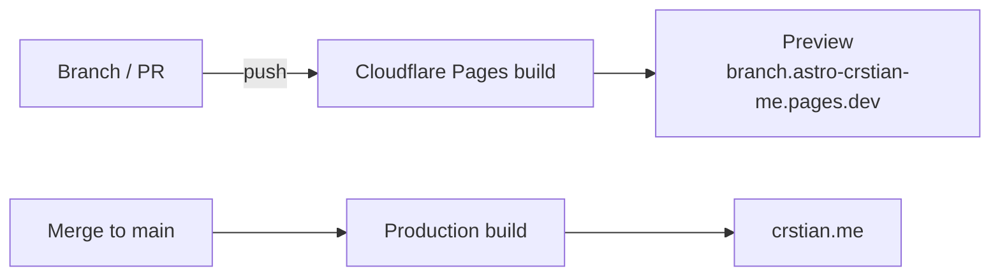

# Deployment

<!-- In-repo doc. English. Relative Markdown links only. -->

How crstian.me is built and published, and how a version is archived on old.crstian.me when it is retired.

---

## Cloudflare Pages

The site is the Cloudflare Pages project **`astro-crstian-me`**, connected to this GitHub repo.

| Setting | Value |
|---|---|
| Production branch | `main` → [crstian.me](https://crstian.me) |
| Build command | `bun run astro build` |
| Output directory | `dist` |
| Environment | `BUN_VERSION` pins Bun on the build image |
| Previews | Every branch and pull request, at `<branch>.astro-crstian-me.pages.dev`; the bot comments the URL on the PR |

Cloudflare's build skips `astro check`; run `bun run build` locally (check + build) before opening a PR.



## Checks on pull requests

| Check | What it does |
|---|---|
| Cloudflare Pages | The preview build must succeed |
| `test` (`.github/workflows/secrets.yaml`) | TruffleHog secret scan on pushes to `main` and on every PR |
| GitGuardian | Secret scan |

`renovate.json` keeps dependencies up to date with Renovate PRs; `stale.yaml` closes inactive issues.

## Archiving a version on old.crstian.me

[old.crstian.me](https://old.crstian.me) keeps every past version of the site under its year (`/2018/`, `/2019/`, `/2024/`). It is a separate repo, **crstian19/Crstianweb**, published by the Pages project `old-crstianweb` from its `Crstian/` folder.

When this site is replaced by a new one, freeze it there before merging the new version:

```sh
# in this repo, on the commit to archive
bun run build

# in ~/Dev/Crstianweb
python3 tools/snapshot.py ~/Dev/astro-crstian.me/dist 2026
```

`tools/snapshot.py` copies `dist/` to `Crstian/2026/`, points its root-relative URLs at `/2026/`, fixes links that islands create in the browser, removes analytics and shrinks big images. Then add a screenshot (`Crstian/assets/2026.webp`) and an entry to the timeline in `Crstian/index.html`; the Crstianweb README has the details.
